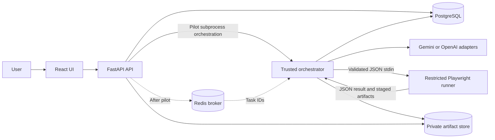

# BugAI — Complete Implementation Blueprint & Microtask Backlog

**Version:** 1.1 — 23 October 2026
**Basis:** User-supplied *BugAI — AI-Powered Automated Software Testing & Bug Reporting Platform* specification.
**Status:** Local foundation added; product capabilities remain planned unless task evidence states otherwise.
**Audience:** Solo developer / AI-assisted development team.
**Architecture baseline:** React + TypeScript + Tailwind; FastAPI + PostgreSQL; Redis + Celery; TypeScript Playwright runner; Gemini or OpenAI; Docker Compose; local or MinIO/S3 evidence storage; GitHub Actions.

> **Scope convention:** The capacity-based local pilot in Section 12 is the first release. Phases 00–20 retain the full-product backlog; Phase 21 is future scope. Phase windows are sequencing labels, not calendar estimates. CI and the controlled fixture start in the foundation. `BUGAI_BACKLOG.json` is authoritative; run `python scripts/backlog.py --write` after changes.

## 1. Product outcome and non-negotiable design principles

BugAI lets an authenticated platform user register an **authorized** website, inspect its pages and elements, generate structured test candidates using Gemini or OpenAI, review and approve candidates, execute the approved specifications with controlled Playwright actions, inspect results and evidence, triage *suspected* bugs, and export reports. It is an approved-target QA platform, **not** a generic web crawler or an LLM code execution service.

1. **Authorization before network access:** explicit owner consent/scope; requests, redirects, browser subresources and DNS/network egress are constrained. Never use real third-party sites as test targets without authorization.
2. **LLM proposes; deterministic code decides:** AI output is untrusted data; schema, semantics, target scope, action allowlists and human approvals gate all execution. No arbitrary AI-generated JavaScript, browser scripts or shell commands.
3. **Security is cross-cutting:** SSRF/DNS rebinding/redirect controls, target data redaction, auth and isolation cannot be postponed until a final security sprint.
4. **Evidence before claims:** a failed assertion is not automatically a genuine product defect. Differentiate product failure, flaky test, bad locator, network failure and runner/infrastructure failure; retain provenance for human review.
5. **Immutable history:** each run freezes exact approved test case revisions, discovery snapshot, model/prompts and environment.
6. **Incremental delivery:** implement → run unit/contract test → integrate → document evidence → commit. Every phase has an exit gate.
7. **Bounded execution:** cap pages, runtime, requests, bytes, concurrent browsers, retries, AI calls, storage and downloads. Defaults are settings, not security bypasses.
8. **MVP vs future:** future categories, integrations and collaborative features are listed but not implied supported in the MVP.

## 2. Selected defaults and scope

| Decision | Selected default | Why it matters |
|---|---|---|
| Platform identity | Single-user local-only pilot; public/multi-user identity deferred | Local-first identity is explicit; public accounts require a separate release gate. |
| Browser | Chromium first | Cross-browser matrix remains future work. |
| Testing target | Bundled controlled fixture only for pilot; public targets require a separate safety gate | Deterministic verification and SSRF safety. |
| Execution language | Narrow versioned JSON action/expectation DSL | Never execute generated source code. |
| Crawler | Scope-constrained breadth-first inventory | Prevent open-ended crawling. |
| Task orchestration | Trusted subprocess for pilot; Celery + Redis after pilot; durable status in PostgreSQL | Broker delivery can repeat, so jobs must be idempotent. |
| Evidence store | Local dev adapter, S3-compatible adapter as a deploy option | Keep DB small and private evidence access controlled. |
| AI provider | Gemini first; OpenAI after pilot, sharing the strict schema | Provider swapping must not change runner behavior. |
| History | Immutable runs and test revisions | Reproducibility after edits. |
| Deployment | Compose-based local demonstration first | No unsupported claim of public SaaS readiness. |
| Destructive testing | Disabled throughout pilot; separately scoped later | Protect target data and external systems. |
| Streaming status | Polling initially, real-time push later if needed | Simpler robust MVP and deployment. |
| Report formats | JSON + safely escaped HTML | Full-MVP exports; pilot displays local results and screenshots only. |
| Accessibility, performance, visual | Future test categories | These categories remain future scope. |

### Scope boundary notes

- **Platform authentication** (access to BugAI projects/data) is different from **target-site authentication** (tests logging into an app being tested). MVP should have safe platform access, while target-auth browser workflows stay post-MVP unless re-scoped.
- A project owner clicking "I am authorized" is not, by itself, proof of authority; include allowed target scopes, safe terms and meaningful enforcement.
- The former six-week windows are superseded by dependency-based gates and provisional pilot effort estimates. No calendar delivery promise is made.
- Decisions, exact hard limits, subprocess ownership, and fixture/public network separation are specified in `docs/ARCHITECTURE_DECISIONS.md`. These policies require runtime verification before release.

## 3. Architecture and runtime ownership



**Trust boundaries:** React is untrusted client input; target web content is untrusted; AI output is untrusted; Redis queue payloads are not executable; the runner is a sandboxed execution capability with least-privileged network access; the runner holds no DB, broker, provider or artifact-store credentials and never joins the control-plane network; artifact downloads are authorization checked; API keys and test credentials never enter browser UI bundles or public reports.

**Suggested service ownership:** `frontend` owns UI; `backend/app/api` exposes routes; `backend/app/domain` owns state machines and security policies; `backend/app/repositories` owns DB access; `backend/app/services/{discovery,ai,generation,reporting}` coordinates workflows; `backend/app/workers` owns Celery entry points; `runner/src` validates DSL and performs Playwright operations; `infra` contains Compose, container and network policies.

## 4. Phase sequencing and milestone gates

| Phase | Name | Window | Prerequisites | Gate |
|---|---|---|---|---|
| 00 | Product requirements, boundaries and design decisions | Foundation | None | Written scope, architecture, threat model and review gates approved. |
| 01 | Repository, tooling and developer workstation | Foundation | 00 | Documented frontend, API and controlled fixture skeleton; shared contracts and CI available; data-service profiles are optional until integrated. |
| 02 | Backend platform and persistence | After pilot | 01 | Migrations, API scaffolding and database transactions run in tests and Compose. |
| 03 | Platform authentication, authorization and tenant boundaries | After pilot | 02 | Users can access only their own projects, runs and artifacts. |
| 04 | Frontend design system and app shell | After pilot | 01, 02, 03 | Accessible responsive app shell can load typed API data. |
| 05 | Projects, settings and project ownership flows | After pilot | 02, 03, 04 | Create, read, edit and delete a project from UI to database. |
| 06 | Target authorization, URL policy and network defense | After pilot | 00, 02, 05 | Unsafe destinations and out-of-scope navigation fail closed before browser access. |
| 07 | Website discovery service and persisted page inventory | After pilot | 01, 02, 06 | Authorized small site is crawled reproducibly with bounded page/element inventory. |
| 08 | Website discovery user experience | After pilot | 04, 07 | Users can launch discovery and inspect evidence-backed page inventory. |
| 09 | Gemini/OpenAI provider-independent AI integration | After pilot | 01, 02, 07 | Both selected providers return normalized, validated typed responses or controlled errors. |
| 10 | AI test generation and strict test specification schema | After pilot | 07, 09 | Generation produces useful test scenarios that pass semantic validation, never arbitrary scripts. |
| 11 | Test case review, editing and explicit approval | After pilot | 04, 10 | Only validated, approved and correctly-versioned test specs are runnable. |
| 12 | Celery/Redis queues and job lifecycle orchestration | After pilot | 02, 06, 10, 11 | Retries, cancellation and crashes converge on a consistent state machine. |
| 13 | Controlled Playwright execution engine | After pilot | 06, 11, 12 | Runner executes only the approved action DSL in isolated browser context. |
| 14 | Evidence capture, artifact storage and execution results | After pilot | 02, 12, 13 | Failures have durable, authorized evidence that can be inspected and downloaded. |
| 15 | AI-assisted failure analysis and fix suggestions | After pilot | 09, 13, 14 | Failure summaries are evidence-grounded hypotheses, not automatically confirmed defects. |
| 16 | Bug report workflow and human verification | After pilot | 14, 15 | Suspected bugs are reviewable, reproducible and never silently auto-confirmed. |
| 17 | Dashboard, history and downloadable reports | After pilot | 04, 05, 08, 11, 14, 16 | User can review run history and export accurate, safe evidence-backed reports. |
| 18 | Integrated quality verification and benchmark expansion | After pilot | 07, 10, 13, 14, 15, 16, 17 | All nine repository full-MVP success scenarios pass against controlled demo application. |
| 19 | Security, privacy, reliability and cost hardening | After pilot | 06, 09, 12, 13, 14, 18 | Critical security cases and operational recovery tests pass before release. |
| 20 | Release packaging, deployment documentation and handoff | After pilot | 01, 18, 19 | Release candidate is reproducible, documented, and shows the complete MVP workflow. |
| 21 | Post-MVP roadmap (explicitly deferred, not forgotten) | After pilot | 20 | Each future capability has a scoped specification, security review and regression tests. |

**Critical path:** scope/architecture → project CRUD and ownership → safe target policy → discovery → structured AI specification → review/approval → queue + controlled execution → evidence/results → suspected bug triage → reports → holistic E2E/security/deployment. The full-product path follows pilot validation. The pilot uses the selected subprocess contract and integrates end to end before adding broader capabilities.

### Mandatory early thin vertical slice

After the foundation fixture, shared contracts, safety policy and CI are ready, implement the pilot packages in Section 12: **create project → record authorized fixture scope → discover one page → generate one valid test → review and approve it → run one safe Playwright assertion → persist result and screenshot → view it in React.** Use the trusted subprocess contract for the pilot; queue-based execution follows later. Never bypass target/network safety. The fixed foundation smoke test proves browser startup only, not this full workflow.

## 5. Full implementation backlog

Generated by `scripts/backlog.py` from `BUGAI_BACKLOG.json`; edit the JSON only.

These are full-product work items, not the first-release commitment. The smaller pilot is in Section 12.

Phase dependencies describe full phase gates. Task dependencies describe implementation order. Unestimated full-product work has no delivery date.

### Phase 00 — Product requirements, boundaries and design decisions (Foundation; Full MVP)

**Exit gate:** Written scope, architecture, threat model and review gates approved.
**Prerequisites:** None

#### Scope and user stories

- [x] **BGA-0001** Confirm single-user local MVP versus multi-user account MVP
  **Done when:** Decision recorded; security and data model reflect it.
  **Evidence:** docs/VERIFICATION.md; docs/ARCHITECTURE_DECISIONS.md; scripts/check.py
- [ ] **BGA-0002** Define primary personas and user journeys
  **Done when:** At least project creation, discovery, generation, review, execution and reporting documented.
- [ ] **BGA-0003** Write in-scope functional, UI, form, negative, boundary and navigation behaviors
  **Done when:** Each has a concrete acceptance scenario.
- [ ] **BGA-0004** Mark authentication, CRUD, accessibility, visual regression and performance testing as future test categories
  **Done when:** Current MVP does not promise unsupported runners.
- [ ] **BGA-0005** Clarify account registration/login versus target-site authentication
  **Done when:** Platform identity is scoped separately from target credentials.
- [ ] **BGA-0006** Define test ownership and authorized-target consent policy
  **Done when:** Confirmation and revocation workflow are documented.
- [ ] **BGA-0007** Define test data safety and non-destructive default
  **Done when:** Sensitive/destructive operations require explicit review and separate enablement.
- [x] **BGA-0008** Define supported browser and environment for MVP
  **Done when:** Chromium and local Docker explicitly chosen or alternatives recorded.
  **Evidence:** docs/VERIFICATION.md; docs/ARCHITECTURE_DECISIONS.md; scripts/check.py
- [x] **BGA-0009** Set maximum pages, depth, duration, concurrency and test count
  **Done when:** Configurable defaults and hard ceilings recorded.
  **Evidence:** docs/VERIFICATION.md; docs/ARCHITECTURE_DECISIONS.md; scripts/check.py
- [ ] **BGA-0010** Write measurable MVP success scenarios
  **Done when:** Each of the nine repository full-MVP success criteria has executable validation evidence.
- [ ] **BGA-0011** Define out-of-scope features and prioritized backlog
  **Done when:** Deferred work is explicitly tracked, not silently omitted.
#### Architecture and delivery decisions

- [ ] **BGA-0012** Create high-level context and container diagrams
  **Done when:** Browser, API, DB, worker, Redis, runner, AI and artifacts are depicted.
- [x] **BGA-0013** Choose runner invocation and isolation contract
  **Done when:** One runner execution boundary, transport and cleanup method documented.
  **Evidence:** docs/VERIFICATION.md; docs/ARCHITECTURE_DECISIONS.md; scripts/check.py
- [ ] **BGA-0014** Specify backend modular-monolith package boundaries
  **Done when:** Routers, domain services, repositories, schemas and integrations identified.
- [ ] **BGA-0015** Choose API versioning, async status conventions and pagination
  **Done when:** Contract document states paths, errors, version rules and examples.
  **Evidence:** docs/VERIFICATION.md; docs/ARCHITECTURE_DECISIONS.md; scripts/check.py
- [ ] **BGA-0016** Specify environments and secrets management approach
  **Done when:** Local, CI and optional deployment paths are separated.
- [x] **BGA-0017** Record initial Architecture Decision Records
  **Done when:** AI adapters, storage, job architecture, identity and safety decisions justified.
  **Evidence:** docs/VERIFICATION.md; docs/ARCHITECTURE_DECISIONS.md; scripts/check.py
- [ ] **BGA-0018** Create requirements-to-test traceability method
  **Done when:** Every requirement maps to planned test(s) and work item(s).
- [ ] **BGA-0019** Set definition of ready and definition of done
  **Done when:** Tasks require inputs, outputs, automated tests and evidence before closure.

### Phase 01 — Repository, tooling and developer workstation (Foundation; Full MVP)

**Exit gate:** Documented frontend, API and controlled fixture skeleton; shared contracts and CI available; data-service profiles are optional until integrated.
**Prerequisites:** Phase 00

#### Repository scaffolding

- [ ] **BGA-0020** Initialize Git repository with protected main branch policy
  **Done when:** Default branch and PR review rules documented.
- [x] **BGA-0021** Create frontend, backend, runner, infra and docs directories
  **Done when:** Structure matches architecture and repository guide.
  **Evidence:** docs/VERIFICATION.md; docs/ARCHITECTURE_DECISIONS.md; scripts/check.py
- [x] **BGA-0022** Add README, contribution guide and license decision note
  **Done when:** Basic project purpose, local steps and license status documented.
  **Evidence:** docs/VERIFICATION.md; docs/ARCHITECTURE_DECISIONS.md; scripts/check.py
- [x] **BGA-0023** Define branch, commit and issue naming conventions
  **Done when:** Example branch and conventional commit appear in CONTRIBUTING.
  **Evidence:** docs/VERIFICATION.md; docs/ARCHITECTURE_DECISIONS.md; scripts/check.py
- [x] **BGA-0024** Set up .gitignore for Python, Node, secrets and artifacts
  **Done when:** Keys, virtual environments and traces are untracked.
  **Evidence:** docs/VERIFICATION.md; docs/ARCHITECTURE_DECISIONS.md; scripts/check.py
- [ ] **BGA-0025** Commit .env.example with nonsecret placeholders
  **Done when:** Required configuration can be discovered without leaked keys.
- [ ] **BGA-0026** Add editorconfig, code formatters and lint configuration
  **Done when:** Formatting and lint commands run in all three codebases.
- [x] **BGA-0027** Pin runtimes, dependency managers and lockfiles
  **Done when:** Clean installs are reproducible from committed files.
  **Evidence:** docs/VERIFICATION.md; docs/ARCHITECTURE_DECISIONS.md; scripts/check.py
- [ ] **BGA-0028** Create root task commands or Makefile
  **Done when:** One documented command performs lint, tests and startup.
#### Local services

- [ ] **BGA-0029** Scaffold frontend React, TypeScript and Tailwind project
  **Done when:** Development server renders a known welcome page.
- [x] **BGA-0030** Scaffold FastAPI Python application
  **Done when:** /health endpoint responds in a local process.
  **Evidence:** docs/VERIFICATION.md; docs/ARCHITECTURE_DECISIONS.md; scripts/check.py
- [x] **BGA-0031** Scaffold TypeScript Playwright runner package
  **Done when:** Minimal runner can launch and close an isolated local browser.
  **Evidence:** docs/VERIFICATION.md; docs/ARCHITECTURE_DECISIONS.md; scripts/check.py
- [ ] **BGA-0032** Create backend, frontend and runner Dockerfiles
  **Done when:** Individual images build without root-only application execution.
- [ ] **BGA-0033** Create Docker Compose services for frontend, API and database
  **Done when:** Services communicate via named internal networks.
- [ ] **BGA-0034** Add Redis and a Celery worker service
  **Done when:** Worker can consume a sample job using Redis.
- [ ] **BGA-0035** Mount scoped development volumes and health checks
  **Done when:** Container restart and readiness can be verified.
- [ ] **BGA-0036** Document Docker and non-Docker developer workflow
  **Done when:** Fresh developer can follow setup without hidden steps.
#### Controlled demo application and reset fixtures

- [x] **BGA-0278** Build authorized demo app with navigation, links and forms
  **Done when:** Discovery has known inventory and testable controls.
  **Evidence:** docs/VERIFICATION.md; docs/ARCHITECTURE_DECISIONS.md; scripts/check.py
- [ ] **BGA-0279** Add positive and negative input validation cases
  **Done when:** Generator/executor can test valid and invalid values.
- [x] **BGA-0280** Add boundary conditions and accessible labels
  **Done when:** Min/max constraints and locators have deterministic behavior.
  **Evidence:** docs/VERIFICATION.md; docs/ARCHITECTURE_DECISIONS.md; scripts/check.py
- [ ] **BGA-0281** Inject at least one known functional defect with documented repro
  **Done when:** AI triage detects a real failure scenario.
- [ ] **BGA-0282** Add broken navigation target and timeout scenario
  **Done when:** Runner captures expected failure/error distinction.
- [ ] **BGA-0283** Add explicit fake credentials and stable fixtures, no real accounts
  **Done when:** Demo E2E runs without sensitive production data.
- [ ] **BGA-0284** Define repeatable DB and browser reset between test runs
  **Done when:** Repeated CI runs have same expected outcomes.
#### Continuous verification from the foundation

- [ ] **BGA-0313** Configure GitHub Actions for frontend/backend/runner lint and type checks
  **Done when:** Each PR gets clear pass/fail statuses.
- [ ] **BGA-0314** Add backend unit/API, frontend and runner contract test jobs
  **Done when:** Failing tests block merge.
- [ ] **BGA-0315** Run integration suite against ephemeral PostgreSQL and Redis services
  **Done when:** CI does not depend on developer machine.
- [ ] **BGA-0316** Add cached dependency installs and browser provisioning
  **Done when:** Repeat CI is reliable and bounded.

### Phase 02 — Backend platform and persistence (After pilot; Full MVP)

**Exit gate:** Migrations, API scaffolding and database transactions run in tests and Compose.
**Prerequisites:** Phase 01

#### FastAPI platform

- [ ] **BGA-0037** Design backend package boundaries for API, core, domain, repositories and services
  **Done when:** Imports avoid circular dependencies.
- [ ] **BGA-0038** Add typed settings with environment validation
  **Done when:** Missing critical variables fail startup with safe messages.
- [ ] **BGA-0039** Implement dependency injection for database and service providers
  **Done when:** Routes can use fake dependencies in tests.
- [ ] **BGA-0040** Define request/response schema validation conventions
  **Done when:** Bad payload returns structured 422 response.
- [ ] **BGA-0041** Add centralized exception mapping and error codes
  **Done when:** 400/401/403/404/409/429/500 cases are consistent.
- [ ] **BGA-0042** Add request correlation IDs and structured JSON logging
  **Done when:** A request can be traced across API and jobs.
- [ ] **BGA-0043** Implement liveness and readiness probes
  **Done when:** Readiness fails when configured dependencies are unavailable.
- [ ] **BGA-0044** Configure CORS allowlist and trusted proxy headers
  **Done when:** Unexpected origins and untrusted forwarding are rejected.
- [ ] **BGA-0045** Add OpenAPI metadata, examples and API route prefix
  **Done when:** Swagger documents only intended public routes.
- [ ] **BGA-0046** Write backend smoke, schema and exception tests
  **Done when:** Stable HTTP status and response formats verified.
#### PostgreSQL and migration discipline

- [ ] **BGA-0047** Configure SQLAlchemy database connection/session lifecycle
  **Done when:** Connections close and rollback on failures.
- [ ] **BGA-0048** Initialize Alembic migrations
  **Done when:** Migration upgrades and downgrades work on a scratch database.
- [ ] **BGA-0049** Establish UUID identifiers, timestamps, deletion policy and ownership fields
  **Done when:** Entity conventions are consistent across tables.
- [ ] **BGA-0050** Implement users, projects and settings models
  **Done when:** Uniqueness, ownership and nullability constraints tested.
- [ ] **BGA-0051** Implement pages and discovered_elements models
  **Done when:** Elements reference a page and carry stable locator metadata.
- [ ] **BGA-0052** Implement discovery_jobs and AI_generation_jobs models
  **Done when:** Status, attempts, errors and timing are persisted.
- [ ] **BGA-0053** Implement test_cases and test_case_versions models
  **Done when:** Revisions are immutable and linked to approvals.
- [ ] **BGA-0054** Implement test_runs, test_results and step_results models
  **Done when:** Execution snapshots, order and timing are persisted.
- [ ] **BGA-0055** Implement bugs and bug_evidence links
  **Done when:** Each suspected bug links to source failure and artifacts.
- [ ] **BGA-0056** Implement artifacts and artifact_retention models
  **Done when:** Metadata identifies owner, checksum, MIME and expiry.
- [ ] **BGA-0057** Add indexes, foreign keys, cascading rules and unique constraints
  **Done when:** Explain plans and referential behavior verified.
- [ ] **BGA-0058** Create reproducible development seed fixtures
  **Done when:** Demo records are loaded without production credentials.
- [ ] **BGA-0059** Test migration from empty DB and a populated DB
  **Done when:** CI verifies upgrade path and basic rollback strategy.

### Phase 03 — Platform authentication, authorization and tenant boundaries (After pilot; Full MVP)

**Exit gate:** Users can access only their own projects, runs and artifacts.
**Prerequisites:** Phase 02

#### Account and session security

- [ ] **BGA-0060** Choose an authentication approach and document lifecycle
  **Done when:** Local accounts or managed identity is explicit and threat-modelled.
- [ ] **BGA-0061** Implement user registration or documented single-user local mode
  **Done when:** Chosen identity path has no anonymous production access.
- [ ] **BGA-0062** Implement password hashing and secure credential validation if local accounts are used
  **Done when:** Cleartext passwords never stored or logged.
- [ ] **BGA-0063** Implement login, logout and token/session expiration
  **Done when:** Expired, revoked and malformed sessions are rejected.
- [ ] **BGA-0064** Implement account-level rate limits and generic login failure messages
  **Done when:** Enumeration and brute force are constrained.
- [ ] **BGA-0065** Implement current-user dependency and login-required route guards
  **Done when:** Protected endpoints reject anonymous requests.
- [ ] **BGA-0066** Build auth security tests including cross-account access
  **Done when:** Unauthorized access fails without leaking objects.
#### Ownership and permissions

- [ ] **BGA-0067** Attach owner_user_id to projects and derived entities
  **Done when:** Every resource has a verifiable owner chain.
- [ ] **BGA-0068** Enforce authorization at repository/service boundaries
  **Done when:** Guessing another resource ID returns no data.
- [ ] **BGA-0069** Implement policy checks for discovery, generation, approval and run operations
  **Done when:** User and resource permissions checked server-side.
- [ ] **BGA-0070** Protect artifact delivery with authorized signed access or proxied download
  **Done when:** Raw storage paths are not publicly guessable.
- [ ] **BGA-0071** Define simple role model or explicitly defer team RBAC
  **Done when:** No ambiguous admin/team assumptions remain.
- [ ] **BGA-0072** Audit sensitive approvals and credential operations
  **Done when:** Audit events record actor, action, time and target ID.

### Phase 04 — Frontend design system and app shell (After pilot; Full MVP)

**Exit gate:** Accessible responsive app shell can load typed API data.
**Prerequisites:** Phase 01, Phase 02, Phase 03

#### Frontend application scaffolding

- [ ] **BGA-0073** Implement routing, navigation and protected page layout
  **Done when:** Unknown and unauthorized routes have dedicated states.
- [ ] **BGA-0074** Create design tokens for colors, typography, spacing and status
  **Done when:** Screens reuse tokens rather than one-off styling.
- [ ] **BGA-0075** Build accessible buttons, inputs, forms, tables and dialogs
  **Done when:** Keyboard focus, labels and invalid states work.
- [ ] **BGA-0076** Implement typed API client generated or aligned with OpenAPI
  **Done when:** Client types match API request and response contracts.
- [ ] **BGA-0077** Handle API errors, 401 refresh/log-out and network outages globally
  **Done when:** User sees actionable, safe feedback.
- [ ] **BGA-0078** Add loading, empty, error, confirmation and success states
  **Done when:** Reusable components are present in a showcase page.
- [ ] **BGA-0079** Implement responsive dashboard shell and mobile navigation
  **Done when:** Core workflows usable on narrow and wide viewports.
- [ ] **BGA-0080** Implement form schema validation and submit locking
  **Done when:** Invalid forms cannot call mutation endpoints.
- [ ] **BGA-0081** Add error boundaries and safe client diagnostics
  **Done when:** Unexpected UI crashes display recoverable screen.
- [ ] **BGA-0082** Configure frontend unit and browser-level UI smoke tests
  **Done when:** Key components and navigation have tests.

### Phase 05 — Projects, settings and project ownership flows (After pilot; Full MVP)

**Exit gate:** Create, read, edit and delete a project from UI to database.
**Prerequisites:** Phase 02, Phase 03, Phase 04

#### Backend projects and settings

- [ ] **BGA-0083** Define project create/update payloads and canonical URL rules
  **Done when:** Input contract documented and validated.
- [ ] **BGA-0084** Implement POST /api/projects with ownership
  **Done when:** Created record has expected user and normalized metadata.
- [ ] **BGA-0085** Implement GET /api/projects with pagination and search
  **Done when:** Multiple records return stable ordering and page limits.
- [ ] **BGA-0086** Implement GET /api/projects/{id} with authorization
  **Done when:** Owner gets detail and non-owner gets no access.
- [ ] **BGA-0087** Implement PATCH /api/projects/{id} and optimistic revision check
  **Done when:** Conflicting edits return 409.
- [ ] **BGA-0088** Implement DELETE /api/projects/{id} with safe soft-delete or blocked active-run behavior
  **Done when:** Deletion semantics and dependencies verified.
- [ ] **BGA-0089** Implement project settings and selection of test categories
  **Done when:** Defaults and overrides validate against accepted enums.
- [ ] **BGA-0090** Implement authorized-target acknowledgment state on projects
  **Done when:** Target consent and scope are timestamped and auditable.
- [ ] **BGA-0091** Write API integration tests for all project mutations
  **Done when:** Success, invalid input and unauthorized cases pass.
#### Project management screens

- [ ] **BGA-0092** Create projects list with empty state, filters and pagination
  **Done when:** User can browse multiple projects without stale state.
- [ ] **BGA-0093** Create new project form and authorized-use notice
  **Done when:** Project cannot be submitted without acknowledgment.
- [ ] **BGA-0094** Create project detail page with URL, settings and metrics placeholders
  **Done when:** Saved values round-trip from API.
- [ ] **BGA-0095** Create edit and delete flows with confirmations
  **Done when:** Invalid and destructive actions have clear warning states.
- [ ] **BGA-0096** Wire project-specific navigation across discovery/tests/runs/bugs
  **Done when:** Breadcrumbs preserve selected project context.
- [ ] **BGA-0097** Add end-to-end create/read/update/delete smoke scenario
  **Done when:** Browser test asserts persisted changes.

### Phase 06 — Target authorization, URL policy and network defense (After pilot; Full MVP)

**Exit gate:** Unsafe destinations and out-of-scope navigation fail closed before browser access.
**Prerequisites:** Phase 00, Phase 02, Phase 05

#### Authorization and target scope

- [ ] **BGA-0098** Define explicit owner authorization evidence and acceptable target policy
  **Done when:** User-facing consent and scope fields are specified.
- [ ] **BGA-0099** Define allowed origin/hostname/path and optional port constraints
  **Done when:** Tests cannot silently expand beyond granted scope.
- [ ] **BGA-0100** Implement target scope creation and revocation endpoints
  **Done when:** Revocation blocks new and pending jobs, cancels running work and invalidates affected approvals.
- [ ] **BGA-0101** Implement server-side target policy check before each job
  **Done when:** Unauthorized or expired scope cannot enqueue work.
- [ ] **BGA-0102** Define safe behavior for authentication-required and public demo targets
  **Done when:** MVP does not assume provided secrets are safe.
#### URL and browser egress hardening

- [ ] **BGA-0103** Parse and normalize URLs using standards-aware parsers
  **Done when:** Malformed, credentialed or parser-ambiguous URLs rejected.
- [ ] **BGA-0104** Allow HTTP/HTTPS only and restrict ports by explicit policy
  **Done when:** file, data, ftp, ws and nonapproved ports blocked.
- [ ] **BGA-0105** Reject localhost, private, link-local, loopback, multicast and metadata networks for public-target mode
  **Done when:** Public-target egress denies IPv4/IPv6 unsafe destinations; the trusted isolated fixture profile is separate and cannot be selected by project input.
- [ ] **BGA-0106** Validate DNS answers and prevent re-resolution TOCTOU bypass
  **Done when:** Connection uses verified destination, not unchecked DNS result.
- [ ] **BGA-0107** Recheck final destinations on redirects, subresources and navigation
  **Done when:** Allowed pages cannot redirect or request forbidden hosts.
- [ ] **BGA-0108** Prevent browser access to container infrastructure and control plane
  **Done when:** Runner network policy blocks Redis, DB and service metadata.
- [ ] **BGA-0109** Apply explicit allowed destination policy at egress/network layer
  **Done when:** Browser sandbox cannot bypass app URL validator.
- [ ] **BGA-0110** Limit redirects, page size, downloads, requests and total bytes
  **Done when:** Navigation fails safely on quota thresholds.
- [ ] **BGA-0111** Block downloads, popups, service workers and websocket flows unless explicitly needed
  **Done when:** Unexpected network expansion is controlled.
- [ ] **BGA-0112** Prohibit arbitrary proxy configuration and unsanctioned DNS settings
  **Done when:** User input cannot disable destination policy.
- [ ] **BGA-0113** Write SSRF regression test matrix for IP notation, rebinding, redirects and IPv6
  **Done when:** Unsafe cases are caught at resolver and browser boundaries.

### Phase 07 — Website discovery service and persisted page inventory (After pilot; Full MVP)

**Exit gate:** Authorized small site is crawled reproducibly with bounded page/element inventory.
**Prerequisites:** Phase 01, Phase 02, Phase 06

#### Discovery engine

- [ ] **BGA-0114** Define discovery job payload, limits and state machine
  **Done when:** Request supports scope, depth, page count and deterministic statuses.
- [ ] **BGA-0115** Create browser discovery worker interface and lifecycle
  **Done when:** Browser launch, context creation and cleanup always execute.
- [ ] **BGA-0116** Implement entry-page navigation and timeout handling
  **Done when:** Valid page captured; timeout produces structured failure.
- [ ] **BGA-0117** Implement in-scope link extraction and canonicalization
  **Done when:** Same URL variants deduplicate correctly.
- [ ] **BGA-0118** Implement bounded breadth-first crawling with visited set
  **Done when:** Page cap and depth cap always enforced.
- [ ] **BGA-0119** Capture page title, URL, HTTP status and basic metadata
  **Done when:** Persisted metadata matches test fixture site.
- [ ] **BGA-0120** Extract buttons, links, visible inputs and textareas
  **Done when:** Element records include role, type and accessible name.
- [ ] **BGA-0121** Extract forms, labels, constraints, selects and submit controls
  **Done when:** Required/type/min/max constraints are captured.
- [ ] **BGA-0122** Build robust locator candidate list (role/label/test-id/CSS fallback)
  **Done when:** Candidates are serializable and ranked with justification.
- [ ] **BGA-0123** Capture navigation relations and dynamic content after page readiness
  **Done when:** Loading strategy has finite waits and known limits.
- [ ] **BGA-0124** Detect disabled, hidden and readonly elements and flag testability
  **Done when:** Unsupported controls are not falsely marked executable.
- [ ] **BGA-0125** Handle failed pages, authentication redirects and CAPTCHA blocks gracefully
  **Done when:** Partial discovery returns meaningful per-page errors.
- [ ] **BGA-0126** Treat page content as untrusted; sanitize before storage/display/AI
  **Done when:** Scripts and prompt instructions cannot affect application control.
- [ ] **BGA-0127** Write discovery fixture tests for forms, links, duplicates and timeouts
  **Done when:** Expected inventory matches a known demo site.
#### Discovery persistence and API

- [ ] **BGA-0128** Add POST /api/projects/{id}/discover and job status endpoint
  **Done when:** Async job ID returned and can be polled.
- [ ] **BGA-0129** Persist discovered pages and elements in versioned snapshots
  **Done when:** Old tests can refer to their original discovery snapshot.
- [ ] **BGA-0130** Expose GET discovery snapshots/pages/elements endpoints
  **Done when:** Paginated filters return only authorized project resources.
- [ ] **BGA-0131** Avoid duplicate concurrent discovery jobs for same target configuration
  **Done when:** Idempotency key or 409 behavior is tested.
- [ ] **BGA-0132** Persist per-page crawl errors and aggregate statistics
  **Done when:** Partial success can be distinguished from total failure.

### Phase 08 — Website discovery user experience (After pilot; Full MVP)

**Exit gate:** Users can launch discovery and inspect evidence-backed page inventory.
**Prerequisites:** Phase 04, Phase 07

#### Discovery interface

- [ ] **BGA-0133** Build discovery settings panel for scope, depth and category preferences
  **Done when:** UI only submits bounded valid settings.
- [ ] **BGA-0134** Build start-discovery action with consent and disabled duplicate submit
  **Done when:** New job appears exactly once.
- [ ] **BGA-0135** Display queued/running/completed/failed/cancelled states
  **Done when:** Progress and terminal errors are distinguishable.
- [ ] **BGA-0136** Implement polling with cleanup/backoff and retry affordances
  **Done when:** Navigating away does not leave runaway timers.
- [ ] **BGA-0137** Build discovered pages list with filters and crawl error badges
  **Done when:** Inventory can be inspected without opening target site.
- [ ] **BGA-0138** Build elements table with locator, label, type and testability
  **Done when:** Discovered item fields match backend snapshot.
- [ ] **BGA-0139** Show warning when stale discovery snapshot conflicts with target changes
  **Done when:** User can decide to rediscover.
- [ ] **BGA-0140** Create browser E2E discovery workflow for fixture site
  **Done when:** User sees expected forms and buttons in dashboard.

### Phase 09 — Gemini/OpenAI provider-independent AI integration (After pilot; Full MVP)

**Exit gate:** Both selected providers return normalized, validated typed responses or controlled errors.
**Prerequisites:** Phase 01, Phase 02, Phase 07

#### Provider adapters and settings

- [ ] **BGA-0141** Define model/provider configuration interface independent of SDKs
  **Done when:** Domain code does not import provider-specific types.
- [ ] **BGA-0142** Create Gemini adapter with configurable model and timeout
  **Done when:** Provider can produce schema-compatible generation response.
- [ ] **BGA-0143** Create OpenAI adapter with configurable model and timeout
  **Done when:** Provider can produce same normalized result schema.
- [ ] **BGA-0144** Implement secret loading and per-environment provider configuration
  **Done when:** API keys exist only on backend.
- [ ] **BGA-0145** Choose structured-output mechanisms supported by configured models
  **Done when:** Adapter negotiates schema support and safe fallback policy.
- [ ] **BGA-0146** Normalize token usage, latency, model ID and request ID
  **Done when:** Provider calls share comparable telemetry.
- [ ] **BGA-0147** Implement retry with jitter for transient provider failures
  **Done when:** No unbounded retry or retry on validation rejection.
- [ ] **BGA-0148** Implement per-job token, dollar-budget proxy, request and timeout limits
  **Done when:** Exceeding budget yields safe terminal job status.
- [ ] **BGA-0149** Add test doubles and recorded provider-independent fixtures
  **Done when:** CI passes without paid API calls.
- [ ] **BGA-0150** Add adapter contract tests for rate limits, malformed data and outages
  **Done when:** Both adapters satisfy one interface.
#### AI input safety and prompt design

- [ ] **BGA-0151** Define structured generation input schema (page inventory, requirements, categories)
  **Done when:** Prompt payload has enforced size and allowed fields.
- [ ] **BGA-0152** Redact secrets, passwords, personal data and cookies from AI input
  **Done when:** Unit tests assert sensitive markers absent.
- [ ] **BGA-0153** Separate instructions from untrusted target-page text
  **Done when:** Injection text stays data; no tool or permission elevation.
- [ ] **BGA-0154** Version system prompts and expose internal prompt revision metadata
  **Done when:** Run can be reproduced against known prompt version.
- [ ] **BGA-0155** Specify refusal, truncation and unsupported schema behavior
  **Done when:** Failure codes are distinguishable and actionable.
- [ ] **BGA-0156** Store minimal metadata, not full secrets or sensitive prompts by default
  **Done when:** Data retention and diagnostics policy is honored.

### Phase 10 — AI test generation and strict test specification schema (After pilot; Full MVP)

**Exit gate:** Generation produces useful test scenarios that pass semantic validation, never arbitrary scripts.
**Prerequisites:** Phase 07, Phase 09

#### Canonical test case DSL

- [x] **BGA-0157** Define TestCase JSON schema for title, goal, category, preconditions, steps and expected outcomes
  **Done when:** Versioned schema has machine-checked examples.
  **Evidence:** docs/VERIFICATION.md; docs/ARCHITECTURE_DECISIONS.md; scripts/check.py
- [x] **BGA-0158** Define supported action enum for navigate, click, fill, select, check and submit
  **Done when:** Unknown action types are rejected.
  **Evidence:** docs/VERIFICATION.md; docs/ARCHITECTURE_DECISIONS.md; scripts/check.py
- [x] **BGA-0159** Define supported assertion enum for URL, visibility, enabled, text, value and attribute
  **Done when:** Each assertion has bounded operands and semantics.
  **Evidence:** docs/VERIFICATION.md; docs/ARCHITECTURE_DECISIONS.md; scripts/check.py
- [x] **BGA-0160** Define discovered-element-ID locator schema and page origin constraints
  **Done when:** All target selectors use approved locator types.
  **Evidence:** docs/VERIFICATION.md; docs/ARCHITECTURE_DECISIONS.md; scripts/check.py
- [ ] **BGA-0161** Design deterministic step IDs, order and parameter limits
  **Done when:** Cycles, invalid order and oversized payloads rejected.
- [ ] **BGA-0162** Define test data representation with synthetic values and redaction rules
  **Done when:** No accidental credential/exfiltration payloads.
- [ ] **BGA-0163** Implement JSON schema plus semantic validation of all generated tests
  **Done when:** Reject unsafe target, invented element and impossible action.
- [ ] **BGA-0164** Implement deterministic normalization and deduplication of similar tests
  **Done when:** Repeated generation does not multiply same scenario.
- [ ] **BGA-0165** Define risk flags for destructive actions and authorization preconditions
  **Done when:** Unsafe candidate is blocked until approved policy exists.
- [ ] **BGA-0166** Add schema version migration or rejection policy
  **Done when:** Old specs have explicit upgrade or fail behavior.
#### Test generation service

- [ ] **BGA-0167** Write generation prompts for functional, UI, validation, negative and boundary tests
  **Done when:** Each selected category returns at least one relevant candidate on fixture.
- [ ] **BGA-0168** Map discovered elements and requirements into bounded generation context
  **Done when:** Prompt references existing page and element IDs.
- [ ] **BGA-0169** Add POST /api/projects/{id}/generate-tests with snapshot reference
  **Done when:** Endpoint creates async generation job and status record.
- [ ] **BGA-0170** Validate outputs before database write and store rejection reasons
  **Done when:** Invalid AI JSON never enters executable test store.
- [ ] **BGA-0171** Store prompt/model/snapshot provenance and generated test version
  **Done when:** Each test has traceable source and schema version.
- [ ] **BGA-0172** Add coverage estimate and warning for untestable requirements
  **Done when:** UI can distinguish generated coverage from guaranteed correctness.
- [ ] **BGA-0173** Deduplicate or supersede generation output safely
  **Done when:** Existing user edits and approvals are not overwritten.
- [ ] **BGA-0174** Write fixtures for valid, empty, unsafe, hallucinated and partial AI outputs
  **Done when:** Service handles all with clear outcomes.

### Phase 11 — Test case review, editing and explicit approval (After pilot; Full MVP)

**Exit gate:** Only validated, approved and correctly-versioned test specs are runnable.
**Prerequisites:** Phase 04, Phase 10

#### Review backend

- [ ] **BGA-0175** Implement test case list/detail API with search and category filters
  **Done when:** Paginated case list is scoped to project.
- [ ] **BGA-0176** Implement PATCH test case fields with schema revalidation
  **Done when:** Edited cases cannot bypass semantic validation.
- [ ] **BGA-0177** Track immutable revisions and audit who changed a test
  **Done when:** Old approved version can be inspected.
- [ ] **BGA-0178** Implement explicit approve/unapprove operation with revision matching
  **Done when:** Approval is invalidated on executable step changes.
- [ ] **BGA-0179** Add bulk approval only for eligible low-risk cases
  **Done when:** Dangerous or invalid cases are excluded.
- [ ] **BGA-0180** Provide rejection and archive status with reason
  **Done when:** Rejected candidates cannot enter execution queue.
- [ ] **BGA-0181** Ensure approval checks revalidate target scope and destructive actions
  **Done when:** Stale authorization blocks activation.
#### Review frontend

- [ ] **BGA-0182** Build case list with category, status, coverage and risk filters
  **Done when:** Reviewer can find blocked and editable candidates.
- [ ] **BGA-0183** Build test detail screen with human-readable preconditions and steps
  **Done when:** Steps and expectations are easy to audit.
- [ ] **BGA-0184** Build form-based step editor restricted to allowed DSL values
  **Done when:** UI cannot inject arbitrary JS or shell.
- [ ] **BGA-0185** Show validation messages inline and display test revision history
  **Done when:** Invalid edits have actionable errors.
- [ ] **BGA-0186** Create approval/rejection controls with confirmation and risk warning
  **Done when:** Approved status only after successful server response.
- [ ] **BGA-0187** Create generate-review-edit-approve E2E browser test
  **Done when:** Approved persisted case matches edited version.

### Phase 12 — Celery/Redis queues and job lifecycle orchestration (After pilot; Full MVP)

**Exit gate:** Retries, cancellation and crashes converge on a consistent state machine.
**Prerequisites:** Phase 02, Phase 06, Phase 10, Phase 11

#### Queue and lifecycle

- [ ] **BGA-0188** Define state machines for discovery, generation and test runs
  **Done when:** No impossible or backward terminal transitions allowed.
- [ ] **BGA-0189** Separate queue routing for crawl, AI and browser execution
  **Done when:** Workload queues can be bounded independently.
- [ ] **BGA-0190** Register Celery tasks with structured IDs and serialized primitive payloads
  **Done when:** No arbitrary code or secret payload is queued.
- [ ] **BGA-0191** Implement transactional job creation plus enqueue/outbox strategy
  **Done when:** DB record and task dispatch cannot silently diverge.
- [ ] **BGA-0192** Implement idempotency keys, at-most-one active run rules and attempt counters
  **Done when:** Duplicate delivery cannot create duplicate results.
- [ ] **BGA-0193** Add transient retry policy with exponential backoff and jitter
  **Done when:** Retry attempts and error classification are observable.
- [ ] **BGA-0194** Add soft/hard time limits plus user-initiated cancellation path
  **Done when:** Worker, browser and DB reach terminal state.
- [ ] **BGA-0195** Implement worker heartbeat, stalled task detection and reconciliation
  **Done when:** Abandoned running jobs are surfaced and recovered.
- [ ] **BGA-0196** Add concurrency and per-user/project quotas
  **Done when:** One user cannot exhaust all runners.
- [ ] **BGA-0197** Persist stage progress, timestamps and sanitized errors
  **Done when:** Polling returns monotonic coherent progress.
- [ ] **BGA-0198** Test broker loss, duplicate delivery, worker kill and cancellation races
  **Done when:** No dangling running state remains.

### Phase 13 — Controlled Playwright execution engine (After pilot; Full MVP)

**Exit gate:** Runner executes only the approved action DSL in isolated browser context.
**Prerequisites:** Phase 06, Phase 11, Phase 12

#### Runner contract and restrictions

- [ ] **BGA-0199** Define signed or authenticated runner input contract with exact test revision
  **Done when:** Runner rejects mismatched or stale specs.
- [ ] **BGA-0200** Implement isolated browser/container lifecycle per job or bounded batch
  **Done when:** No cross-project cookies, files or state leak.
- [ ] **BGA-0201** Run browser process as non-root with resource, PID, memory and CPU ceilings
  **Done when:** Container escapes and exhaustion risk reduced.
- [ ] **BGA-0202** Configure network egress, download, clipboard and service permissions
  **Done when:** Browser cannot access unapproved resources.
- [ ] **BGA-0203** Disallow eval, arbitrary scripts, arbitrary Playwright code and shell commands from AI
  **Done when:** DSL dispatcher has explicit action allowlist.
- [ ] **BGA-0204** Validate project target and step origin again within runner
  **Done when:** Worker bypassing API cannot widen scope.
- [ ] **BGA-0205** Implement deterministic locale, timezone, viewport and timeout defaults
  **Done when:** Fixtures reproduce under documented settings.
- [ ] **BGA-0206** Implement cleanup for cancellation, timeout, crash and success
  **Done when:** No orphan browser or leaked file remains.
#### Action executor

- [ ] **BGA-0207** Implement navigate action with target policy and redirect rechecks
  **Done when:** Page only navigates to allowed origins.
- [ ] **BGA-0208** Implement click by validated discovered element ID and approved locator mapping
  **Done when:** Missing or ambiguous locators produce typed errors.
- [ ] **BGA-0209** Implement fill and clear with nonsecret test data
  **Done when:** Values applied to intended element or fail clearly.
- [ ] **BGA-0210** Implement select option, checkbox and radio interactions
  **Done when:** Correct options chosen with checked assertions.
- [ ] **BGA-0211** Implement submit action with explicit form scope
  **Done when:** Unexpected destructive submits stay blocked.
- [ ] **BGA-0212** Implement visibility, enabled, text and input-value assertions
  **Done when:** Both passing and failing fixture assertions are reported.
- [ ] **BGA-0213** Implement URL and attribute assertions with controlled matching rules
  **Done when:** Open redirects and wrong attributes are detectable.
- [ ] **BGA-0214** Implement step timeout, navigation timeout and max-duration budgeting
  **Done when:** Infinite scripts or waits cannot occur.
- [ ] **BGA-0215** Record per-step duration, locator used and assertion evidence
  **Done when:** Failure points are attributable to an exact step.
- [ ] **BGA-0216** Implement test isolation and ordering within a run
  **Done when:** Running A does not change B without declared fixture state.
#### Runner integration

- [ ] **BGA-0217** Define stable runner result schema and exit/status codes
  **Done when:** Python worker parses success and errors deterministically.
- [ ] **BGA-0218** Add start-run endpoint with approved-version checks
  **Done when:** Unapproved specs yield 403/409 and do not launch browser.
- [ ] **BGA-0219** Persist run snapshot with selected tests and config
  **Done when:** Later edits cannot rewrite historical run definition.
- [ ] **BGA-0220** Implement run status/detail and result endpoints
  **Done when:** Run progress and step evidence appear through API.
- [ ] **BGA-0221** Write runner contract tests with Python/TypeScript compatibility fixtures
  **Done when:** Schema changes fail CI before deployment.
- [ ] **BGA-0222** Write success/failure/timeout/cancellation runner E2E tests
  **Done when:** Each terminal path persists expected outcome.

### Phase 14 — Evidence capture, artifact storage and execution results (After pilot; Full MVP)

**Exit gate:** Failures have durable, authorized evidence that can be inspected and downloaded.
**Prerequisites:** Phase 02, Phase 12, Phase 13

#### Evidence and storage

- [ ] **BGA-0223** Define artifact types and filenames for screenshots, traces, logs and reports
  **Done when:** MIME, size and extensions are allowlisted.
- [ ] **BGA-0224** Choose local storage abstraction with optional MinIO/S3 adapter
  **Done when:** Domain uses stable storage interface.
- [ ] **BGA-0225** Implement screenshot capture at failure with optional per-step sampling
  **Done when:** Failure fixture yields timestamped screenshot.
- [ ] **BGA-0226** Implement Playwright trace capture for failed tests
  **Done when:** Trace opens and can be associated to test and run.
- [ ] **BGA-0227** Capture sanitized console, navigation and assertion messages
  **Done when:** Logs omit credentials and sensitive headers.
- [ ] **BGA-0228** Calculate SHA-256, artifact size, owner and storage key
  **Done when:** Metadata supports integrity checks.
- [ ] **BGA-0229** Store artifact writes atomically and reconcile partial uploads
  **Done when:** Broken uploads do not masquerade as valid evidence.
- [ ] **BGA-0230** Implement artifact retention, deletion and garbage collection job
  **Done when:** Expired artifacts cannot be served.
- [ ] **BGA-0231** Implement authorized download with content type and safe Content-Disposition
  **Done when:** Non-owner downloads fail and XSS payloads do not execute.
- [ ] **BGA-0232** Test oversized or corrupted artifacts and failed storage
  **Done when:** Runner reports degradation without false pass.
#### Result semantics

- [ ] **BGA-0233** Define pass/fail/skipped/error/cancelled and flaky/retried interpretation
  **Done when:** Aggregate counts have consistent denominators.
- [ ] **BGA-0234** Separate product assertion failure from runner/infrastructure failure
  **Done when:** Only actionable failures become suspected bugs.
- [ ] **BGA-0235** Save failure evidence links, timing and retry attempt history
  **Done when:** Results show what happened on each attempt.
- [ ] **BGA-0236** Implement run summary calculation and atomic completion
  **Done when:** Completion occurs only after result persist succeeds.
- [ ] **BGA-0237** Define rerun failed test and rerun entire set behavior
  **Done when:** Re-run creates new records and preserves old evidence.
- [ ] **BGA-0238** Write database and API tests for result aggregation and consistency
  **Done when:** Counts match underlying results on sample fixtures.

### Phase 15 — AI-assisted failure analysis and fix suggestions (After pilot; Full MVP)

**Exit gate:** Failure summaries are evidence-grounded hypotheses, not automatically confirmed defects.
**Prerequisites:** Phase 09, Phase 13, Phase 14

#### Failure triage pipeline

- [ ] **BGA-0239** Define analysis input schema of failed step, assertion, screenshot metadata and logs
  **Done when:** AI receives only scoped evidence.
- [ ] **BGA-0240** Filter secrets, cookies, tokens, personal info and irrelevant page content
  **Done when:** Provider-bound payload is redacted.
- [ ] **BGA-0241** Create analyze_failure() provider-independent service
  **Done when:** Gemini/OpenAI adapters return common typed analysis.
- [ ] **BGA-0242** Define output fields: summary, observed/expected, cause hypothesis, repro, confidence and references
  **Done when:** Schema is versioned and validated.
- [ ] **BGA-0243** Define suggest_fix() with safe advisory output, no autonomous code modification
  **Done when:** Suggestions cannot execute or deploy changes.
- [ ] **BGA-0244** Label uncertain findings and classify insufficient evidence explicitly
  **Done when:** UI never asserts speculative bug as confirmed.
- [ ] **BGA-0245** Implement analysis job retries and provider-outage fallback
  **Done when:** Original test failure remains visible without AI.
- [ ] **BGA-0246** Persist model/prompt/evidence provenance and analysis cost metadata
  **Done when:** Reports disclose source and generated nature.
- [ ] **BGA-0247** Add fixtures for selector drift, timeout, actual defect and infrastructure error
  **Done when:** AI pipeline rejects unsupported conclusions.

### Phase 16 — Bug report workflow and human verification (After pilot; Full MVP)

**Exit gate:** Suspected bugs are reviewable, reproducible and never silently auto-confirmed.
**Prerequisites:** Phase 14, Phase 15

#### Bug domain and API

- [ ] **BGA-0248** Create bug lifecycle suspected/confirmed/rejected/duplicate/resolved
  **Done when:** Allowed transitions and actor recorded.
- [ ] **BGA-0249** Define severity, priority, category and confidence independently
  **Done when:** User can distinguish business impact from AI uncertainty.
- [ ] **BGA-0250** Implement suspected-bug creation from failed test analysis
  **Done when:** Bug references original step, run and evidence.
- [ ] **BGA-0251** Generate clear reproducible steps with environment and inputs
  **Done when:** Reviewer can reproduce from stored record.
- [ ] **BGA-0252** Implement deduplication using project, symptom and affected route
  **Done when:** Similar failures can link without losing history.
- [ ] **BGA-0253** Add bug list/detail/status update API with resource authorization
  **Done when:** Only owner can triage their bug reports.
- [ ] **BGA-0254** Allow reviewer notes, manual corrections and evidence attachments
  **Done when:** Human decision is preserved in history.
- [ ] **BGA-0255** Add download-safe HTML/JSON bug report representation
  **Done when:** Report references evidence without leaking private storage URLs.
#### Bug review UI

- [ ] **BGA-0256** Build suspected bug list with severity, status and test-run filters
  **Done when:** Reviewer can separate unconfirmed and confirmed defects.
- [ ] **BGA-0257** Build bug detail with expected/actual, reproduction steps and linked screenshot
  **Done when:** Core evidence visible without raw JSON.
- [ ] **BGA-0258** Show AI confidence/provenance and evidence insufficiency warning
  **Done when:** Hypotheses are visually distinct from verified facts.
- [ ] **BGA-0259** Add confirm/reject/duplicate/resolved actions with audit history
  **Done when:** UI updates do not silently delete findings.
- [ ] **BGA-0260** Add direct navigation from failed result to associated bug
  **Done when:** User can trace failure to report and back.
- [ ] **BGA-0261** Write full failure-to-triage E2E flow
  **Done when:** A known broken demo page leads to human-confirmed report.

### Phase 17 — Dashboard, history and downloadable reports (After pilot; Full MVP)

**Exit gate:** User can review run history and export accurate, safe evidence-backed reports.
**Prerequisites:** Phase 04, Phase 05, Phase 08, Phase 11, Phase 14, Phase 16

#### Dashboard and history

- [ ] **BGA-0262** Define metrics and denominators (tests run, pass rate, failures, runs, candidate bugs)
  **Done when:** UI metric formulas documented.
- [ ] **BGA-0263** Implement project dashboard summary API with indexed aggregations
  **Done when:** Counts match DB fixture totals.
- [ ] **BGA-0264** Implement historical runs list with pagination, filter and sort
  **Done when:** User finds runs by date, status or category.
- [ ] **BGA-0265** Implement run detail screen with progress, result summary and per-test outcomes
  **Done when:** Every status has a consistent display.
- [ ] **BGA-0266** Build screenshot and trace access affordances with authorization
  **Done when:** Evidence can be opened only for owned runs.
- [ ] **BGA-0267** Build metrics cards and simple charts with time range selection
  **Done when:** No mixing incomplete and completed runs without label.
- [ ] **BGA-0268** Add empty, offline, partial-run and no-evidence states
  **Done when:** Screens handle sparse and degraded datasets.
#### Export and reporting

- [ ] **BGA-0269** Define versioned report manifest and required metadata
  **Done when:** Each export cites run, target, timestamp and schema version.
- [ ] **BGA-0270** Build server-side JSON report export
  **Done when:** Output passes JSON schema and contains results and summaries.
- [ ] **BGA-0271** Build safely escaped HTML report export
  **Done when:** HTML injection from target content is neutralized.
- [ ] **BGA-0272** Include environment, model, approved tests, failures and evidence references
  **Done when:** Report can explain how results were produced.
- [ ] **BGA-0273** Implement artifact links or bounded embedded screenshots under access policy
  **Done when:** Download works without unprotected private URLs.
- [ ] **BGA-0274** Support large report generation and streaming/download constraints
  **Done when:** Export has maximum size and meaningful error.
- [ ] **BGA-0275** Validate export encoding, MIME, sanitization and owner check
  **Done when:** Untrusted test text cannot execute when opened.
- [ ] **BGA-0276** Add report snapshot and reproducibility metadata
  **Done when:** Historical export remains stable after new test generation.
- [ ] **BGA-0277** Write golden-file report tests and browser download test
  **Done when:** Fixture report has stable structure and correct totals.

### Phase 18 — Integrated quality verification and benchmark expansion (After pilot; Full MVP)

**Exit gate:** All nine repository full-MVP success scenarios pass against controlled demo application.
**Prerequisites:** Phase 07, Phase 10, Phase 13, Phase 14, Phase 15, Phase 16, Phase 17

#### Automated quality gates

- [ ] **BGA-0285** Write backend unit tests for validators, services and AI schema handling
  **Done when:** Critical domain rules are independently tested.
- [ ] **BGA-0286** Write API and PostgreSQL integration tests using isolated test DB
  **Done when:** Persistence and auth work together.
- [ ] **BGA-0287** Write frontend component tests for forms, state and errors
  **Done when:** User-visible failure handling is exercised.
- [ ] **BGA-0288** Write Python-TypeScript runner contract suite
  **Done when:** Action/result schemas remain compatible.
- [ ] **BGA-0289** Write browser E2E happy path project-to-report scenario
  **Done when:** Core pipeline completes from UI on fresh setup.
- [ ] **BGA-0290** Write browser E2E negative path invalid URL and unapproved test
  **Done when:** Unsafe work is not executed.
- [ ] **BGA-0291** Write provider outage, malformed AI, timeout and worker crash test cases
  **Done when:** Failure modes degrade safely.
- [ ] **BGA-0292** Implement coverage collection and minimum critical-path coverage gate
  **Done when:** CI blocks regression of agreed crucial modules.
- [ ] **BGA-0293** Measure run duration, flakiness and failed-test triage accuracy on demo
  **Done when:** Baseline metrics documented, not asserted without data.
- [ ] **BGA-0294** Verify setup instructions on a clean environment
  **Done when:** Another developer can reproduce demo without undocumented steps.

### Phase 19 — Security, privacy, reliability and cost hardening (After pilot; Full MVP)

**Exit gate:** Critical security cases and operational recovery tests pass before release.
**Prerequisites:** Phase 06, Phase 09, Phase 12, Phase 13, Phase 14, Phase 18

#### Security review

- [ ] **BGA-0295** Perform threat model review for SSRF, RCE, XSS, CSRF, IDOR and prompt injection
  **Done when:** Risks have mitigations and explicit residual owners.
- [ ] **BGA-0296** Check CSRF defenses for cookie-auth mutations or enforce bearer-only model
  **Done when:** Browser cross-site mutation cannot bypass auth.
- [ ] **BGA-0297** Verify headers, CSP, secure cookies and TLS assumptions
  **Done when:** Security checklist passes for configured deployment.
- [ ] **BGA-0298** Audit URL restrictions after DNS changes, browser redirects and subrequests
  **Done when:** Egress never enters blocked network scopes.
- [ ] **BGA-0299** Test AI prompt injection, model hallucinations and unsafe generated actions
  **Done when:** Only validated DSL can reach runner.
- [ ] **BGA-0300** Test storage access control, path traversal and content sniffing
  **Done when:** Arbitrary users cannot read arbitrary artifacts.
- [ ] **BGA-0301** Enforce secrets rotation guidance and redact secrets from logs and traces
  **Done when:** Sensitive values absent from logs, screenshots and traces before persistence; adversarial fixtures prove redaction or explicit capture refusal.
- [ ] **BGA-0302** Scan dependencies, source, containers and committed history for secrets
  **Done when:** Critical alerts remediated or documented.
- [ ] **BGA-0303** Set retention, data export and delete semantics for users/projects
  **Done when:** Deletes cover DB, artifacts and backups by policy.
- [ ] **BGA-0304** Implement resource rate limiting, abuse controls and quotas per account
  **Done when:** User cannot launch unbounded jobs or costs.
#### Operational resilience

- [ ] **BGA-0305** Add timeouts, circuit breakers and backoff for all external calls
  **Done when:** Outages do not hang API or exhaust workers.
- [ ] **BGA-0306** Ensure retry policy does not re-execute destructive steps silently
  **Done when:** Duplicate job delivery is contained by state and policy.
- [ ] **BGA-0307** Add metrics for queue length, worker utilization, run errors and API latency
  **Done when:** Operators can spot saturation and outages.
- [ ] **BGA-0308** Create structured alert thresholds for failed jobs and exhausted quotas
  **Done when:** Alerts include actionable run IDs, not secrets.
- [ ] **BGA-0309** Document DB backup/restore, artifact backup and tested recovery procedure
  **Done when:** Sample restore passes integrity checks.
- [ ] **BGA-0310** Configure log retention, sampling and correlation IDs across services
  **Done when:** A failure can be traced end-to-end.
- [ ] **BGA-0311** Test abrupt worker shutdown, Redis restart, DB restart and artifact store outage
  **Done when:** System recovers or fails to documented state.
- [ ] **BGA-0312** Create operations playbook for stuck jobs, retry storms and disk exhaustion
  **Done when:** Operator has manual recovery steps.

### Phase 20 — Release packaging, deployment documentation and handoff (After pilot; Full MVP)

**Exit gate:** Release candidate is reproducible, documented, and shows the complete MVP workflow.
**Prerequisites:** Phase 01, Phase 18, Phase 19

#### CI/CD and packaging

- [ ] **BGA-0317** Build versioned frontend, backend, worker and runner images
  **Done when:** Same commit produces traceable artifacts.
- [ ] **BGA-0318** Add dependency vulnerability, secret and image scans to CI
  **Done when:** Critical release-blocking findings cannot pass unnoticed.
- [ ] **BGA-0319** Define environment promotion and tagged release procedure
  **Done when:** Release version maps to commit, migrations and images.
- [ ] **BGA-0320** Provide Docker Compose development and production-like profiles
  **Done when:** Service boundaries and secrets differ appropriately.
- [ ] **BGA-0321** Add migration-before-deploy and tested rollback procedure
  **Done when:** Failed deployment can recover compatible state.
- [ ] **BGA-0322** Run full smoke workflow after deployment
  **Done when:** Service readiness and one safe demo test are verified.
#### Documentation and delivery

- [ ] **BGA-0323** Finalize architecture/context diagram and trust-boundary explanation
  **Done when:** Maintainer can trace data flow and network access.
- [ ] **BGA-0324** Publish API schema, auth flow, error catalog and sample requests
  **Done when:** Frontend/runner teams can integrate independently.
- [ ] **BGA-0325** Write data model ERD and migration guide
  **Done when:** New contributors understand relations and schema history.
- [ ] **BGA-0326** Write prompt, JSON DSL and provider adapter design docs
  **Done when:** AI behavior and validation are explainable.
- [ ] **BGA-0327** Document local configuration, deployment, backups and troubleshooting
  **Done when:** Clean machine setup and failure recovery are reproducible.
- [ ] **BGA-0328** Publish user guide for authorized targeting, discovery, review, runs and triage
  **Done when:** User can complete safe workflow independently.
- [ ] **BGA-0329** Record feature coverage, known limitations and deferred backlog
  **Done when:** Unsupported future capabilities are clearly marked.
- [ ] **BGA-0330** Produce demo script, sample artifacts and final release checklist
  **Done when:** A 10–15 minute demonstration shows complete evidence chain.
- [ ] **BGA-0331** Run stakeholder acceptance against nine repository full-MVP criteria
  **Done when:** All checks signed off or explicit exceptions recorded.

### Phase 21 — Post-MVP roadmap (explicitly deferred, not forgotten) (After pilot; Future)

**Exit gate:** Each future capability has a scoped specification, security review and regression tests.
**Prerequisites:** Phase 20

#### Advanced test types

- [ ] **BGA-0332** Add multi-browser Chromium/Firefox/WebKit matrix and browser-version retention
  **Done when:** Same approved DSL runs with browser-specific results.
- [ ] **BGA-0333** Add target-site authentication flows and isolated credential vault
  **Done when:** Secrets are encrypted, access-scoped and never sent to AI.
- [ ] **BGA-0334** Add authorized CRUD workflow tests with isolated fixture/reset support
  **Done when:** Destructive operations require explicit approval and rollback plan.
- [ ] **BGA-0335** Add accessibility scans with rule engine and issue triage
  **Done when:** Findings distinguish automated checks from full accessibility conformance.
- [ ] **BGA-0336** Add visual regression baselines, diffs and reviewer approval
  **Done when:** Expected screenshots are versioned per browser/viewport.
- [ ] **BGA-0337** Add performance and Lighthouse-style test category
  **Done when:** Metrics have controlled device/network/environment and thresholds.
- [ ] **BGA-0338** Add advanced assertions, conditional branching and reusable test fixtures
  **Done when:** DSL remains declarative and validated, never raw scripts.
#### Automation and collaboration

- [ ] **BGA-0339** Add scheduled regression runs with ownership and notification controls
  **Done when:** Recurrence respects authorization, budgets and cancellation.
- [ ] **BGA-0340** Add GitHub Actions trigger support and status publishing
  **Done when:** Repo events can trigger only approved project configs.
- [ ] **BGA-0341** Add Jira/GitHub Issues integration with de-duplication and update rules
  **Done when:** External tickets reflect human-approved reports.
- [ ] **BGA-0342** Add flaky test detection and historical trend analytics
  **Done when:** Repeated outcomes distinguish intermittent from deterministic failures.
- [ ] **BGA-0343** Add team workspaces, roles, invitations and audit trails
  **Done when:** Cross-user and cross-tenant permission tests pass.
- [ ] **BGA-0344** Add email/webhook/Slack-style notifications with retry and redaction
  **Done when:** Alerts respect user preferences and delivery errors.
- [ ] **BGA-0345** Add optional local model adapter (e.g., Ollama)
  **Done when:** Same AI contract and privacy guarantees validated.
- [ ] **BGA-0346** Add scalable runner scheduling and distributed tracing as workloads grow
  **Done when:** Per-tenant limits and queue saturation tests still pass.

## 6. Reference data model (minimum entities and relationships)

- `users`: platform identity, status, password hash or provider identity, timestamps.
- `projects`: owner, URL/origin, name, description, active status, defaults, scope consent.
- `project_target_scopes`: approved hosts/paths/ports, approval source, valid/revoked time.
- `project_settings`: default categories, browser, depth/pages/duration limits, provider choice, execution policy.
- `discovery_jobs`: project, scope snapshot, status/attempts, start/end/error/progress.
- `discovery_snapshots`: project, version, timestamp, crawl stats and hash.
- `pages`: discovery snapshot, normalized URL, title, crawl metadata/status.
- `discovered_elements`: page, element type, labels, constraints, locator candidates and interactability.
- `ai_jobs`: project/snapshot, operation, status, model, prompt/schema revisions, usage and redacted errors.
- `requirements`: project, stable logical ID, source and approval status.
- `requirement_versions`: immutable expected behavior, author/source reference, content digest and timestamp.
- `test_requirement_links`: exact test revision to approved requirement revision mappings.
- `test_cases`: stable logical case ID, project, category, lifecycle status.
- `test_case_versions`: immutable DSL JSON, author/source/model, schema version, timestamps.
- `test_approvals`: specific case version, actor, scope policy, requirement/spec digests, risk signoff and time.
- `test_runs`: project, approved version set snapshot, configuration, status, totals, timing, attempt count.
- `test_results`: run, test case version, outcome, attempts, duration and failure classification.
- `step_results`: test result, step sequence, locator, action/assertion outcome, timings, sanitized message.
- `bugs`: project, originating failure, suspected/confirmed lifecycle, severity, confidence and reviewer decision.
- `bug_events`: audit state transitions and comments.
- `artifacts`: owner/project/run/result/bug references, storage key, SHA-256, MIME, size, expiry.
- `audit_events`: sensitive approvals, access, credential operations, deletion and policy changes.

**DB rules:** UUID PKs, UTC timestamps, foreign keys, owner scoping, indexes for status/date/project, immutable historical revisions, explicit on-delete policies, no credential plaintext, no raw artifact binary storage in main relational tables. Use unique constraints for idempotent job requests and deterministic result IDs.

## 7. API contract checklist

The following routes define the intended full-product contract for job progress, human review and authorization. Product routes use `/api/v1`; health/readiness are unversioned. Only the foundation probes are implemented. Shared schema contracts and lifecycle semantics must be verified before product routes are exposed.

| Method | Route | Purpose |
|---|---|---|
| POST / GET | `/api/v1/projects` | Create and list owned projects |
| GET / PATCH / DELETE | `/api/v1/projects/{id}` | Details, update, controlled delete |
| POST | `/api/v1/projects/{id}/discover` | Queue safe discovery (async 202) |
| GET | `/api/v1/projects/{id}/discoveries/{job_id}` | Discovery progress and errors |
| GET | `/api/v1/projects/{id}/discovery-snapshots/{snapshot_id}/pages` | Page inventory |
| GET | `/api/v1/projects/{id}/discovery-snapshots/{snapshot_id}/elements` | Element inventory |
| POST / GET | `/api/v1/projects/{id}/requirements` | Create and list owned requirements |
| POST | `/api/v1/requirements/{id}/versions` | Create immutable requirement revision |
| POST | `/api/v1/projects/{id}/generate-tests` | Queue AI generation (async 202) |
| GET | `/api/v1/projects/{id}/ai-jobs/{job_id}` | AI job progress and errors |
| GET | `/api/v1/projects/{id}/test-cases` | List case candidates |
| GET / PATCH | `/api/v1/test-cases/{id}` | Detail and edit validated test spec |
| POST | `/api/v1/test-cases/{id}/approve` | Approve exact revision |
| POST | `/api/v1/test-cases/{id}/reject` | Reject candidate |
| POST | `/api/v1/projects/{id}/runs` | Queue tests; approved revision only |
| GET | `/api/v1/runs/{id}` | Run progress and summary |
| POST | `/api/v1/runs/{id}/cancel` | Request cancellation |
| GET | `/api/v1/runs/{id}/results` | Per-test outcomes and evidence |
| GET | `/api/v1/runs/{id}/bugs` | Suspected bug list |
| GET | `/api/v1/runs/{id}/report?format=json|html` | Controlled export |
| GET | `/api/v1/artifacts/{id}/download` | Ownership-checked evidence retrieval |
| GET / PATCH | `/api/v1/bugs/{id}` | Human bug review and status |
| GET | `/api/v1/projects/{id}/dashboard` | Aggregate metrics/history |
| GET | `/health`, `/ready` | Liveness/readiness, protect internal diagnostic details |

**Shared API semantics:** request/response versioning; explicit pagination; `202 Accepted` for asynchronous work; stable status enums; typed error envelope and request ID; idempotency keys for queued mutations; `409 Conflict` for invalid state/revisions; `429` for quotas; authentication on all user resources; strict owner authorization; no untrusted storage path exposure. Payload and response schemas for new product routes must be added before exposing them; shared versioning and error semantics are fixed by the architecture decisions.

## 8. Versioned action DSL

The authoritative schema is `contracts/test-case.schema.json`; a valid example is `contracts/examples/test-case.json`. Runner envelopes and results have separate schemas in `contracts/`. Unknown versions, fields, actions, or assertions are rejected. Preconditions are descriptive; executable assertions must reference approved requirement revisions.

Schema validation does not establish authorization or safety. The runner must independently check the exact approved revision, requirement/scope digests, immutable snapshot, known fixture element IDs, paths, hard limits and action policy. No arbitrary code or destructive action is accepted. See `docs/ARCHITECTURE_DECISIONS.md`.

## 9. Job lifecycle and execution rules

- **Common statuses:** `queued → running → completed | failed | cancelled`, with `retry_wait`/`cancelling` where needed. Validate transitions centrally and model partial discovery explicitly.
- **Idempotency:** duplicate requests or broker deliveries must not produce duplicate artifacts/results or repeat unsafe effects. Broker semantics do not guarantee exactly-once side effects. Treat browser interaction retries as especially dangerous.
- **Worker contract:** queue ID + immutable DB record, not arbitrary serialized Python/JS functions; worker fetches authorized/configured version; runner validates again.
- **Timeout budget:** request → queued wait → provider call → browser run → per-step; propagate cancellation and ensure cleanup at every layer.
- **Failure taxonomy:** `invalid_spec`, `unsafe_target`, `provider_error`, `network_error`, `selector_error`, `assertion_failure`, `infra_failure`, `timeout`, `cancelled`, `insufficient_evidence`; do not map all categories to product bug.
- **Run snapshot:** persist submitted selection, approval IDs, test DSL revisions, target policy, browser/runtime/version, fixture data IDs, prompt/schema/model revisions, approved requirement revisions and result timestamps.

## 10. Quality verification matrix

| Layer | Positive checks | Negative/adversarial checks | Release evidence |
|---|---|---|---|
| Backend API | CRUD, auth, schema, queries | Cross-user ID access, malformed data, duplicate requests | Unit + integration CI |
| DB | Migration, constraints, indexing | Rollbacks, duplicate inserts, orphan records | Migration CI |
| Target policy | Approved demo site works | Localhost/private IP, IPv6, metadata, DNS rebinding, redirects | SSRF regression suite + egress test |
| Discovery | Visible links/forms/buttons found | CAPTCHA, timeouts, infinite pagination, out-of-scope URLs | Demo inventory fixture |
| AI | Both adapters produce valid candidates | Provider outage, refusal, invalid JSON, injection, hallucinated element | Schema/contract fixtures |
| Approval | Edited case can be approved | Stale revision, destructive action, invalid DSL | Auth/revision tests |
| Runner | Safe actions and assertions pass | Invalid locator, arbitrary code attempt, origin change, browser crash | Runner E2E and sandbox checks |
| Queue | Job completes/updates state | Duplicate delivery, worker killed, cancellation race | Lifecycle integration test |
| Evidence | Screenshot/trace/report retrievable | Broken upload, oversize, path traversal, unauthorized download | Artifact integration test |
| Bug triage | Repro and evidence linked | Flaky failure, infrastructure error, AI hallucination | Known-bug vs known-nonbug fixtures |
| Reports | Accurate totals and immutable run reference | HTML injection, wrong owner, missing artifacts | Golden snapshot + access tests |
| Frontend | Happy path and responsive screens | Offline API, expired session, partial status | Browser E2E |
| Operations | Compose boot, health, backup | DB/Redis/store/provider outage, recovery | Restore drill + smoke run |

Numeric quality thresholds and expected-behavior provenance are defined in `docs/QUALITY_GATES.md`. The current benchmark is a seed; it must be expanded before the release metrics can be claimed.

**Test data rules:** Use controlled, synthetic accounts and isolated fixture app; never run potentially destructive tests against production targets. Use deterministic IDs/seeds where possible. Keep secrets out of snapshots and traces.

## 11. Per-task delivery playbook (especially for AI-assisted coding)

1. **Choose a single BGA task** and read its parent phase, dependencies, API contract and threat model.
2. **Specify boundaries**: exact files/modules to change, feature behavior, input/output example, and what not to touch.
3. **Write or update the failing automated test first** for critical domain/validation work; otherwise add test in the same patch.
4. **Implement the minimum viable change** behind typed interfaces; avoid introducing unrelated features.
5. **Run the right fast checks**: format, lint, typecheck, unit/contract tests; then focused integration tests.
6. **Prove acceptance criterion** with test result, screenshot, API response or log; store evidence URL in the authoritative JSON tracker and regenerate its views.
7. **Check security and backwards compatibility**: authorization, target scope, redaction, state transitions, migration impact.
8. **Commit a coherent change** referencing BGA ID; update docs/ADRs and move the task to `Done` only when evidence exists.
9. **At each module gate**, run a cross-component test and resolve interface drift before more features are added.
10. **At each phase gate**, run full affected suite and a safe demo workflow; measure not assume readiness.

**Avoid artificial microtasks:** Do not split a 5-line pure function into multiple commits merely to achieve a task count. Conversely, split work again if it crosses many services or cannot be verified in one focused review.

### Copyable AI coding prompt

```text
We are building BugAI using the architecture and safety rules in BUGAI_IMPLEMENTATION_PLAN.md.
Implement ONLY task <BGA-ID>: <TASK TITLE>.
Prerequisites: <PHASE DEPENDENCIES>.
Acceptance criterion: <DONE WHEN>.
Edit only these files/modules: <PATHS>.
Do not implement unrelated tasks. Preserve owner authorization, scoped network policy, strict AI DSL and runner isolation.
First show a short design and tests; then implement the smallest change, run relevant checks, and report exact files changed, results, assumptions and remaining risks.
If an interface is missing, introduce a minimal typed stub and flag the dependency instead of inventing a large subsystem.
```

## 12. First-release pilot and capacity plan

Generated from the JSON `pilot` list. The first release is local, single-user, Chromium-only and limited to the bundled fixture. It includes one provider, reviewed tests, execution, and results with a screenshot. Public targets, Celery, multi-user accounts, AI bug triage, dashboards, and exports follow the pilot.

Estimates below are provisional engineering hours, not measured throughput or calendar promises. Owner is an accountable role; the maintainer assigns a named person before work starts. Work in dependency order with one active package. Re-estimate after the foundation and after the first complete run.

| ID | Work package | Dependencies | Owner | Hours | Status |
|---|---|---|---|---|---|
| PILOT-01 | Reproducible local foundation | None | Project maintainer | 4 | In progress |
| PILOT-02 | Freeze requirements, schemas, limits and network boundaries | PILOT-01 | Project maintainer | 4 | Done |
| PILOT-03 | Persist one local project and requirement revisions | PILOT-02 | Project maintainer | 8 | Not started |
| PILOT-04 | Discover the single controlled fixture page | PILOT-03 | Project maintainer | 6 | Not started |
| PILOT-05 | Generate a validated test through one provider adapter | PILOT-04 | Project maintainer | 8 | Not started |
| PILOT-06 | Review and approve an exact test revision | PILOT-05 | Project maintainer | 6 | Not started |
| PILOT-07 | Execute the approved fixture case in an isolated job | PILOT-06 | Project maintainer | 12 | Not started |
| PILOT-08 | Persist results and screenshot; display them locally | PILOT-07 | Project maintainer | 8 | Not started |
| PILOT-09 | Pass repeatability, safety and benchmark gates | PILOT-08 | Project maintainer | 8 | Not started |
| PILOT-10 | Reproduce the pilot from a clean checkout | PILOT-09 | Project maintainer | 4 | Not started |

Initial pilot estimate: **68 engineering hours**, excluding full-MVP work and contingency. No release date is assigned until actual throughput is available.

Pilot exit gate: every package is Done with evidence, all deterministic fixture checks pass, quality thresholds in `docs/QUALITY_GATES.md` pass, and a clean checkout reproduces the workflow. Full phase gates and the full-MVP acceptance checklist remain required for subsequent capabilities.

## 13. Full-MVP release acceptance checklist

- [ ] **MVP-01** User can register a project and record authorized target scope. *(Phases 03, 05, 06)*
- [ ] **MVP-02** User can discover testable website elements. *(Phases 06, 07, 08)*
- [ ] **MVP-03** User can generate valid test cases with Gemini or OpenAI. *(Phases 09, 10)*
- [ ] **MVP-04** User can review, edit and approve test cases. *(Phase 11)*
- [ ] **MVP-05** User can execute approved cases with Playwright. *(Phases 12, 13)*
- [ ] **MVP-06** User can see accurate test results and screenshots. *(Phases 14, 17)*
- [ ] **MVP-07** User can review evidence-linked *suspected* bugs. *(Phases 15, 16)*
- [ ] **MVP-08** User can export JSON and HTML reports. *(Phase 17)*
- [ ] **MVP-09** Another developer can reproduce local workflow using docs. *(Phases 18, 20)*
- [ ] **SEC-01** Public-target mode blocks unauthorized targets, private addresses, metadata endpoints and out-of-scope redirects at network layer. The controlled fixture uses only its isolated trusted test profile. *(Phases 06, 19)*
- [ ] **SEC-02** Arbitrary LLM-generated scripts cannot be executed. *(Phases 10, 11, 13, 19)*
- [ ] **SEC-03** Runner/browser resources and artifact access are scoped, bounded and auditable. *(Phases 13, 14, 19)*
- [ ] **REL-01** Worker failures, retries, cancellation and provider outages have deterministic behavior. *(Phases 12, 18, 19)*
- [ ] **PROD-01** No project, run, bug, credential or report crosses user ownership boundaries. *(Phases 03, 19)*
- [ ] **DOC-01** API schema, ADRs, setup and runbook are current. *(Phases 00, 20)*

## 14. Risks and mitigation ownership

| Risk | Impact | Planned mitigation |
|---|---|---|
| SSRF / DNS rebinding / browser subresource escape | Critical | Scoped target consent, connection-time IP verification, runner egress policy, adversarial network tests |
| AI invented selectors or executable code | High | Strict DSL + semantic validation + revision approval + allowlisted runner interpreter |
| Runner/container escape or resource exhaustion | Critical | Non-root isolated runtime, least privilege, quotas, restricted network, cleanup and scanning |
| False positive AI bug conclusions | Medium | Test failure classification, evidence grounding, confidence labels, mandatory human verification |
| Leaked credentials in artifacts/model calls | High | Backend vault/secrets, sanitization, limited access and retention |
| Duplicate Celery execution and destructive replays | High | Idempotency, run state validation and no implicit destructive retries |
| Unbounded AI/browser/cloud costs | Medium | Per-user/project quotas, token/time/concurrency limits and usage audit |
| Test flakiness and timing dependence | Medium | Deterministic demo fixtures, stable locators, bounded waits and rerun history |
| Toolchain and schema drift | Medium | Lockfiles, contract suites, migrations, docs and staged release |
| Schedule overrun | High | Thin vertical slice, visible backlog, weekly gates, reduced WIP and MVP/future boundary |

## 15. Source coverage, external technical references and change control

**Coverage basis:** The repository README is the available product overview. No separate original source specification is present, so prior claims of exact source coverage are not independently verified. The full-product acceptance checklist is a proposed repository contract. The document introduces additional engineering tasks where the source does not prescribe details; those are **recommendations to implement**, not claims from the source.

**Implementation reference links (not verification evidence):**

- OWASP SSRF Prevention Cheat Sheet: https://cheatsheetseries.owasp.org/cheatsheets/Server_Side_Request_Forgery_Prevention_Cheat_Sheet.html
- Playwright Trace Viewer: https://playwright.dev/docs/trace-viewer-intro
- Playwright Test options (trace retention): https://playwright.dev/docs/api/class-testoptions
- Celery Task documentation (retries/idempotency): https://docs.celeryq.dev/en/stable/userguide/tasks.html
- OpenAI Structured Outputs: https://developers.openai.com/api/docs/guides/structured-outputs
- Gemini Structured Outputs: https://ai.google.dev/gemini-api/docs/structured-output

**Change-control rule:** Any addition to MVP must identify affected requirements, owner/tenant/security changes, API+DSL schema revisions, new tests and updated timeline. A future feature does not silently become supported merely because a DB table or UI placeholder exists.
